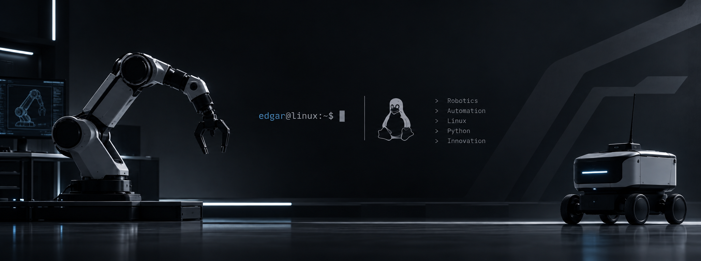

  

# Hi, I'm Omar 👋

**Software Engineer | Teleoperation Supervision & Robotics Fleet Operations**  
Focused on remote robot diagnostics, Linux-based edge systems, automated incident triage, and high-availability fleet supervision for autonomous delivery.

---

### 🤖 About My Work
- 📡 **Teleoperation & Fleet Supervision:** Ensuring real-time operational reliability, remote diagnostics, and human-in-the-loop intervention workflows for autonomous mobile robots.
- 🐧 **Linux & Edge Infrastructure:** Managing remote robot endpoints via **SSH**, automating health checks with **Bash**, and analyzing system logs to minimize fleet downtime.
- 📊 **Data & Incident Triage:** Querying telemetry and operational metrics with **SQL** and **Python** to identify root causes, document edge cases, and track bug resolution in **Jira**.
- 📫 Direct Contact: **[omaredbb2@gmail.com](mailto:omaredbb2@gmail.com)**

---

### 🛠️ Core Tech Stack

**Systems, Scripting & Remote Ops**

**Data, Version Control & Workflow**

---

### 🚀 Key Engineering Projects & Lab Focus
*(Repositories focused on solving real-world teleoperation, telemetry, and remote diagnostics challenges)*

* **Automated Fleet Health & SSH Diagnostic CLI** — A **Python & Bash** tool designed to connect via **SSH** to multiple simulated edge nodes, parse system logs, monitor network latency/packet loss, and flag anomalies before a teleoperation intervention is required.
* **Teleoperation Incident & Telemetry Analyzer** — A **SQL & Python** reporting pipeline that queries intervention logs to categorize edge-case disengagements, measure Mean Time to Recovery (MTTR), and generate structured bug reports ready for **Jira** triage.
* **Remote Robot Watchdog & Failsafe Daemon** — Lightweight **Linux** background service written in **Bash/Python** that monitors critical telemetry processes and triggers safe-state recovery routines during simulated connection drops.

---

### 🤝 Let's Connect

